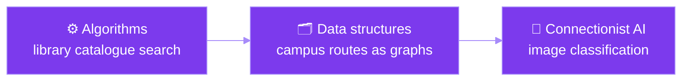
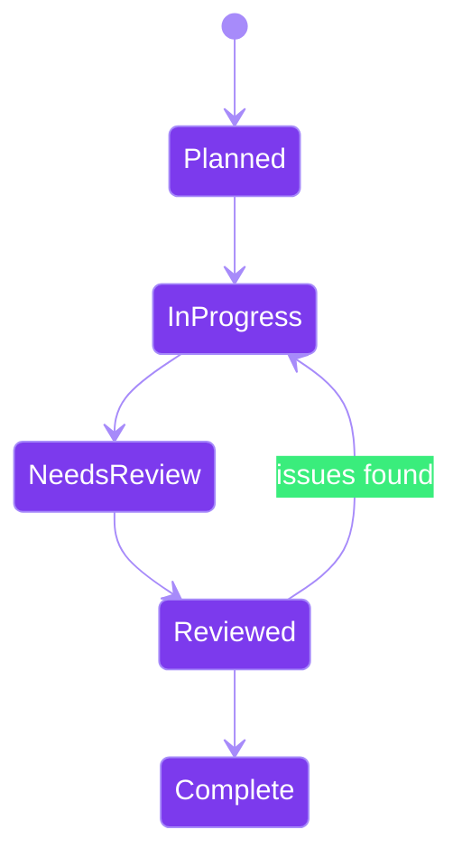

 

**Beginner-friendly learning materials for algorithms, data structures and neural networks.**

[Overview](#-project-overview) · [Objectives](#-stage-1-objectives) · [Progress](#-current-progress) · [Team](#-team-and-responsibilities) · [Workflow](#-workflow-and-quality-checks) · [AI use](#-ai-use-transparency) · [References](#-references)

> [!NOTE]
> **Project status:** Stage 1 work in progress. Update this README as deliverables are reviewed and completed.

## 🟣 Project overview

K.I.V.A.S is a team project for an AI & Computer Science course. The team is developing beginner-friendly learning materials that introduce core computer science and artificial intelligence concepts through explanations, examples, visuals, and supporting study resources.

The initial content scope connects three strands:

<table>
<tr>
<td align="center" width="33%">

### ⚙️ Algorithms
Step-by-step methods for solving problems.

</td>
<td align="center" width="33%">

### 🗂️ Data structures
Ways to organize and work with information.

</td>
<td align="center" width="33%">

### 🧠 Connectionist AI
Introductory concepts behind artificial neural networks and learning from examples.

</td>
</tr>
</table>

The materials use familiar examples, including searching a library catalogue, representing campus routes as graphs, and classifying images. The intention is to make the concepts understandable to first-year learners without assuming advanced prior knowledge.

## 🎯 Stage 1 objectives

The team is working toward a structured set of course materials that can include:

- [ ] 📑 A course and chapter outline.
- [ ] 📝 Markdown source content for lessons and study-guide chapters.
- [ ] 🖥️ Slide or mini-lecture materials.
- [ ] 🎨 Visual assets and diagrams.
- [ ] 🎬 A study-guide video, including preparation and production materials.
- [ ] ❓ Review questions and supporting learning activities.
- [ ] 📚 References and evidence of team contributions.

> [!IMPORTANT]
> Only mark an item as complete after the team has checked the deliverable and its supporting evidence.

## 🚀 Current progress

Based on the team's current status report:

| Area | Status | Details |
|---|---|---|
| 📦 **Repository** |  | Ali (CIO) created the GitHub repository and initial folders and has been transferring team work into the repository through commits. |
| ✍️ **Content** |  | Huseyn (Content Lead) drafted the mini-lecture content and the first study-guide chapter. |
| 🔍 **Quality review** |  | Mahmud (Quality Lead) checked the quality of the first Markdown chapter and consulted on assets/images for the presentation. |
| 🎨 **Visual design** |  | Sadig (Visual Design Lead) created the logo and is working on the initial PowerPoint/slides and overall visual quality. This work is still in progress. |
| 🎬 **Video** |  | Hasan and Asad (Video Leads) have explored tools for a future study-guide video. Video production has **not yet started**. |
| 🗓️ **Coordination** |  | Nihat (CEO) organized two in-person meetings and is coordinating meeting times and the project log. Meeting dates and the second meeting's details should be recorded in the log after verification. |

<b>🔎 Status labels explained (click to expand)</b>

 

- `Planned` — not started.
- `In progress` — work has started but is not complete.
- `Needs review` — a draft exists and requires checking.
- `Reviewed` — review occurred and remaining issues are recorded.
- `Complete` — the team has verified that the deliverable meets the agreed requirements.

## 👥 Team and responsibilities

| Member | Student ID | Role | Main responsibility |
|---|---|---|---|
| **Nihat** 李海 | `1820262201` | 🟣 CEO / Coordinator | Coordinate meetings, track decisions, maintain the project log |
| **Ali** 满⽴ | `1820262285` | 💜 CIO / Repository Lead | GitHub repository, folder structure, commits, and publishing team work |
| **Huseyn** 霍森 | `1820262217` | 🟪 Content Lead | Draft mini-lecture and study-guide content |
| **Mahmud** 穆法 | `1820262247` | 🔮 Quality Lead | Review content clarity, correctness, and relevant assets |
| **Sadig** 萨迪 | `1820262235` | 🎨 Visual Design Lead | Logo, slide design, visual consistency, and asset coordination |
| **Hasan** 韩白 | `1820262209` | 🎬 Video Lead | Explore and prepare the study-guide video workflow with Asad |
| **Asad** 陈德 | `1820262195` | 🎬 Video Lead | Explore and prepare the study-guide video workflow with Hasan |

< img src="assets/divider.svg" width="100%" alt=""/>

## 🛠️ Workflow and quality checks

```mermaid
%%{init: {'theme':'base','themeVariables':{'primaryColor':'#7C3AED','primaryTextColor':'#FFFFFF','primaryBorderColor':'#A78BFA','lineColor':'#A78BFA'}}}%%
flowchart LR
    A["1 · Draft<br/>in Markdown"] --> B["2 · Review<br/>correctness"]
    B --> C["3 · References<br/>verify sources"]
    C --> D["4 · Visuals<br/>diagrams & slides"]
    D --> E["5 · Video<br/>script & storyboard"]
    E --> F["6 · Log<br/>work, AI use, evidence"]
    F --> G["7 · GitHub<br/>commits & PRs"]
    G --> H["8 · Update<br/>status honestly"]
```

1. Draft the content in Markdown.
2. Review concepts, examples, and answers for correctness.
3. Add and verify references for externally sourced claims or visuals.
4. Create diagrams and slides that match the reviewed content.
5. Prepare video scripts/storyboards before recording and editing.
6. Record meaningful work, decisions, AI use, and evidence in the Stage 1 project log.
7. Use GitHub commits and pull requests or an equivalent review process to show changes and review outcomes.
8. Update the status only when the work has actually reached that stage.

## 🤖 AI-use transparency

AI tools may be used to support planning, drafting, explaining concepts, and revising project materials. Significant AI use affecting project content or decisions must be recorded in the Stage 1 project log. Records should identify the user and date, show important prompts and output excerpts, explain how the output was checked, and state what the team accepted, revised, or rejected.

> [!WARNING]
> AI-generated content is a draft, not an automatically verified source. Team members remain responsible for correctness, suitable references, and the final submission. Do not claim that an output was independently checked unless a member actually checked it.

## 🧾 Contribution and evidence records

The team is maintaining a Stage 1 project log and meeting summaries. Evidence should be labelled and readable, for example:

<b>📂 Evidence checklist (click to expand)</b>

 

- Repository history and relevant commit diffs.
- Markdown content and specific review comments.
- Dated versions of the logo and slides.
- Actual meeting notes and follow-up actions.
- AI prompt/output excerpts and the team's verification notes.
- Video-tool exploration notes when documented.

The project log should distinguish completed work from work in progress. In particular, video production has not started yet, and visual design remains in progress according to the team's current report.

## 📚 References

Add verified sources in [`references/references.md`](references/references.md) as research is completed. For each external source, record enough information for a reader to identify it and note which lesson, slide, diagram, or claim it supports. Also record source and licence information for third-party images or other assets where applicable.

## 💬 Team communication

Use meetings and dated group discussions to record significant decisions, responsibilities, and deadlines. Keep routine messages out of the formal log unless they change a decision or affect project progress. Update this README when the repository structure, deliverable status, or team workflow materially changes.

**K.I.V.A.S** · *Learn it. Build it. Understand it.* 💜

